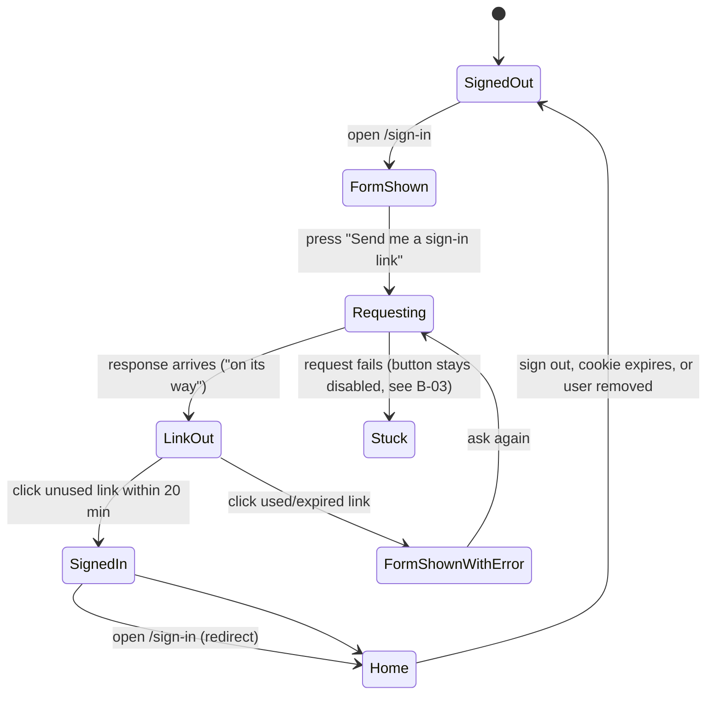

# Sign-in

## 1. Summary

re:matter is invite-only. A person signs in by asking for a sign-in link at `/sign-in` and clicking it in their email. If WorkOS is configured, they can also use their firm's SSO. Either way, the app matches them to an invited user by email, then sends them to their role's home. The sign-in cookie lasts 14 days, and signing out ends it on that browser.

The sign-in page never says whether an address is invited. Every request gets the same "on its way" message.

## 2. The simple case

1. An invited associate opens `/sign-in`. They see the product name, one line about the simulation, a **Work email** field, and a **Send me a sign-in link** button.
2. They type their email and press the button. The form is replaced with: "If that address is on a cohort, a sign-in link is on its way. It is valid for 20 minutes."
3. An email arrives with the subject "Sign in to re:matter", containing the link.
4. They click the link. Their browser is signed in and lands on the inbox at `/`.
5. Two weeks later the cookie expires, and the next page they open sends them back to `/sign-in`.

## 3. The interaction, event by event

### Arriving at the sign-in page

- If the browser is already signed in, `/sign-in` redirects straight to the user's home. They never see the form.
- Any protected page opened without a valid sign-in sends the user to `/sign-in`. They don't come back to the page they asked for afterwards, because sign-in always lands on the role's home.
- If the URL has `?error=...`, a message appears above the form (see the modifiers in section 4).
- The SSO button only appears when WorkOS is configured.

### Leaving without asking for a link

Nothing is stored. The page holds no state beyond what was typed.

### Asking for a link

- The email field is required and must look like an email; the browser enforces this before anything is sent.
- When the button is pressed, it is disabled while the request runs.
- The server lowercases and trims the address. If it matches an invited, not-removed user, it creates a new link and emails it. Otherwise it does nothing.
- In both cases the page shows the same "on its way" message. When there is no email provider (local development), the page also shows **Open the sign-in link (local dev)**.

### While the link is out

- The link is valid for 20 minutes from when it was requested.
- Asking again creates another link. Earlier links stay valid, so several can be live at once.
- The "on its way" message has no way back to the form. To ask again, the user reloads the page.

### Clicking the link

- A valid, unused, unexpired link is marked used, the browser is signed in for 14 days, and the user lands on their home. Associates go to `/`, PD admins to `/pd`, internal raters to `/rater`, and internal admins to `/admin`.
- A used, expired, unknown or missing link lands on `/sign-in` with "That link has expired or was already used. Request a new one."

> **Technical note:** links and signed-in browsers are rows in `magic_links` and `auth_sessions`. Only an HMAC of each token is stored, never the token itself (`apps/web/src/lib/auth.ts:15-17`). The cookie is `rematter_session`: httpOnly, `SameSite=Lax`, and `Secure` in production.

## 4. Modifiers

| Variation | What changes |
|---|---|
| Address isn't invited, or the user was removed | No link is created and no email is sent. The page still says "on its way." |
| Address typed in mixed case or with spaces | It still matches the invited user. |
| No email provider configured | The link is written to the server log, and in development it's also shown as a button on the page. |
| WorkOS configured | **Sign in with your firm's SSO** appears under the form. |
| SSO succeeds for an invited, verified email | Same landing as a link sign-in. The user's WorkOS ID is saved. |
| SSO for an uninvited, unverified or failed account | Lands on `/sign-in` with "That account has not been invited to a cohort." |
| SSO callback with a wrong or missing state | Lands on `/sign-in` with "Sign-in could not be completed. Try again." |
| Any other `?error=` value | Same generic message as above. |
| Role | Decides the home after sign-in, and which pages redirect away. An associate opening `/admin` is sent to `/`. |

## 5. Cancel and interrupt

1. **Explicit abort.** There's no cancel button. Leaving the page abandons the request, but if the request already reached the server, the link was still created and emailed.
2. **The user doing something else mid-way.** Asking again while a link is out creates a second valid link. Clicking any of them works once. Opening a link meant for user B in a browser signed in as user A switches the browser to user B with no warning.
3. **Clean "complete" events.** Clicking the link uses it up. Signing out (**Sign out** posts to `/api/auth/sign-out`) deletes that browser's sign-in and returns to `/sign-in`. Other browsers stay signed in. Opening `/api/auth/sign-out` directly in the address bar returns 405 and does nothing.
4. **The environment failing.**
   - If the link request fails (network down, server error), the button stays disabled and nothing is shown. The user has to reload. **B-03**
   - If the email provider rejects the send, the error is only logged, and the page still says the link is on its way. **B-07**
   - Corporate email scanners (Outlook Safe Links, Mimecast, Proofpoint) open links on delivery. That uses up the link, so the person's own click says "expired." **B-01**
5. **The page or process going away.** Closing the tab after the link is requested doesn't matter, because the link is in the email. The sign-in cookie survives browser restarts until it expires.
6. **Something else changing the target.**
   - If an admin removes the user, every browser they're signed in on is signed out at its next request.
   - A link that was emailed before the removal still gets used up when clicked, and the user sees "expired" instead of being told they no longer have access. **B-04**
   - Re-inviting a removed user lets them sign in again with a new link.
7. **The input channel changing.** Requesting the link on a laptop and opening the email on a phone works: the phone gets signed in, and the laptop doesn't. The two are unrelated.

## 6. Interactions with other systems

- **Permissions.** Sign-in only proves who you are. Each page then checks the role and redirects anyone who doesn't belong to their own home. API routes return 401 or 403 instead of redirecting.
- **History/undo.** Nothing to undo. Sign-ins aren't written to the audit log; `last_seen_at` on the user is updated at each sign-in.
- **Containers.** An associate who isn't in a cohort can still sign in. They land on an inbox page that says "Nothing here yet. You are not in a cohort yet. Ask your PD team for an invitation." along with **Sign out**.
- **Locked/read-only.** Cohort start and end dates aren't checked at sign-in.
- **Offline.** See interrupt 4.
- **Collaboration.** One person can be signed in on many browsers at once. There's no list of signed-in browsers and no "sign out everywhere."
- **Notifications.** The sign-in email is the only email re:matter sends outside the app. The in-game emails stay in the inbox.
- **Configuration.** `APP_URL` sets the link's host. `POSTMARK_SERVER_TOKEN` turns on real email. `WORKOS_API_KEY` and `WORKOS_CLIENT_ID` turn on SSO. `AUTH_SECRET` signs every token, so changing it signs everyone out and voids every outstanding link.

## 7. Edge cases

- There's no limit on link requests. Twenty requests in a row created twenty valid links and, with email on, would send twenty emails. **B-05**
- The "on its way" copy says "if that address is on a cohort". But PD admins, admins and raters aren't in cohorts and do get links, and an associate without a cohort also gets one. **B-06**
- The SSO "not invited" message also appears when the WorkOS exchange fails or the email isn't verified. **B-08**
- Expired links and expired signed-in browsers are never cleaned up. They stay in the database.
- Two clicks on the same link at the same moment could both sign in, because "is it unused?" and "mark it used" are two separate steps. In five concurrent tries locally, only one won. **B-02**

## 8. Open questions and verification

Open questions:

- Should a sign-in return the user to the page they first asked for?
- Should asking for a new link void the earlier ones?
- Should a removed user be told that their access ended?

Verified locally against `cfea6fe` on 2026-11-02 (mock LLM, no Postmark, no WorkOS), using [verification/sign-in.md](../verification/sign-in.md). SSO success and real email delivery weren't run, because they need WorkOS and Postmark credentials.
